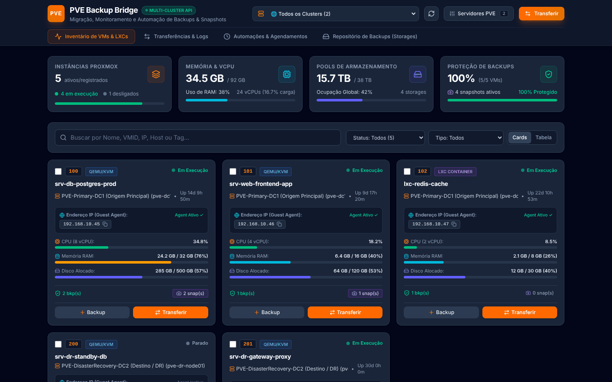
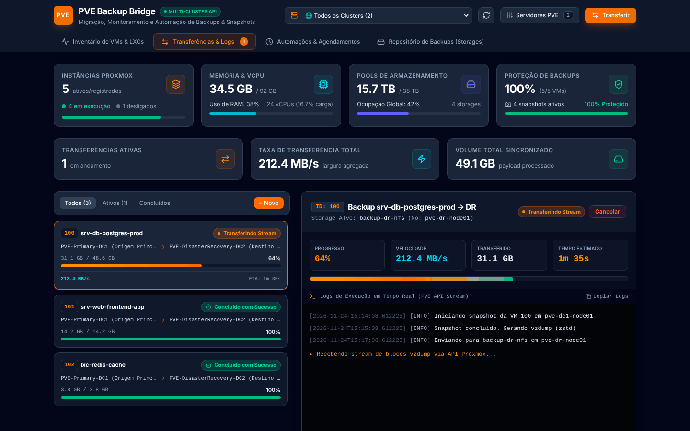
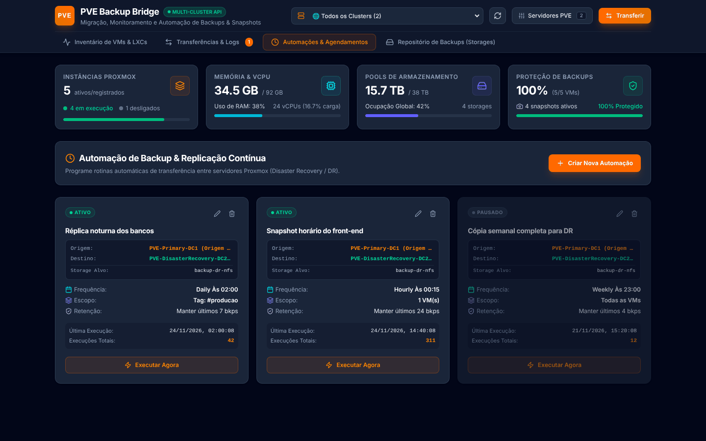
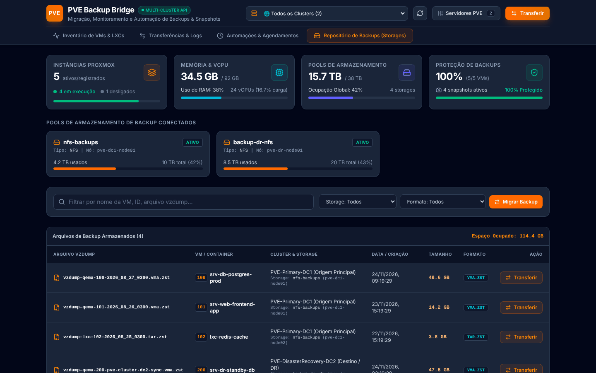

# PVE Backup Bridge

Um painel único para **vários clusters Proxmox VE**: veja todas as VMs e contêineres, crie snapshots e backups sob demanda e organize as rotinas de backup.



## Sobre

Quem cuida de mais de um Proxmox acaba pulando entre várias abas do painel web para conferir VMs e backups. O PVE Backup Bridge junta os servidores num lugar só e deixa as tarefas do dia a dia a um clique: snapshot antes de uma manutenção, backup avulso e acompanhamento das rotinas.

## Funcionalidades

- **Vários servidores Proxmox**, com autenticação por API Token
- **Explorador de VMs e contêineres**: CPU, RAM, disco, IP e snapshots
- **Snapshot e backup agora** (vzdump), com escolha de storage, compressão e modo
- **Explorador de backups** por storage
- **Automações** agendadas, com log em tempo real

### Estado atual

| Recurso | Situação |
|---|---|
| Leitura de VMs, storages e backups | ✅ Funcionando (API do Proxmox) |
| Snapshot e backup sob demanda | ✅ Funcionando (API do Proxmox) |
| Transferência de backup entre servidores | 🚧 Em desenvolvimento: a interface já existe, mas a cópia dos dados ainda não é feita |

O painel começa com servidores de demonstração. Depois de cadastrar um servidor real, use a opção de limpar os dados de demonstração.

## Telas

<table>
<tr><td width="50%" align="center"><br /><sub>Transferência de backup entre clusters, com log ao vivo</sub></td><td width="50%" align="center"><br /><sub>Rotinas automáticas de backup e réplica</sub></td></tr>
<tr><td width="50%" align="center"><br /><sub>Repositório de backups por storage</sub></td></tr>
</table>

## Requisitos

- Node.js 20+
- Proxmox VE 7 ou 8 com um API Token com permissão de leitura de VMs e de backup

## Como rodar

```bash
npm install
npm run dev
```

Abra http://localhost:3000. Para produção: `npm run build && npm start`.

> ⚠️ Para funcionar com os certificados autoassinados que o Proxmox usa por padrão, o servidor desliga a verificação TLS nas conexões. Use em rede interna ou configure um certificado válido no Proxmox.

## Autor

Criado por **Guilherme Dill** · [RUNE Projects](https://www.runeprojects.com.br) · [GitHub](https://github.com/guilhermealceu)

## Licença

[MIT](LICENSE)

<sub>Proxmox é marca registrada da Proxmox Server Solutions GmbH. Este projeto é independente e não tem vínculo com a Proxmox.</sub>
